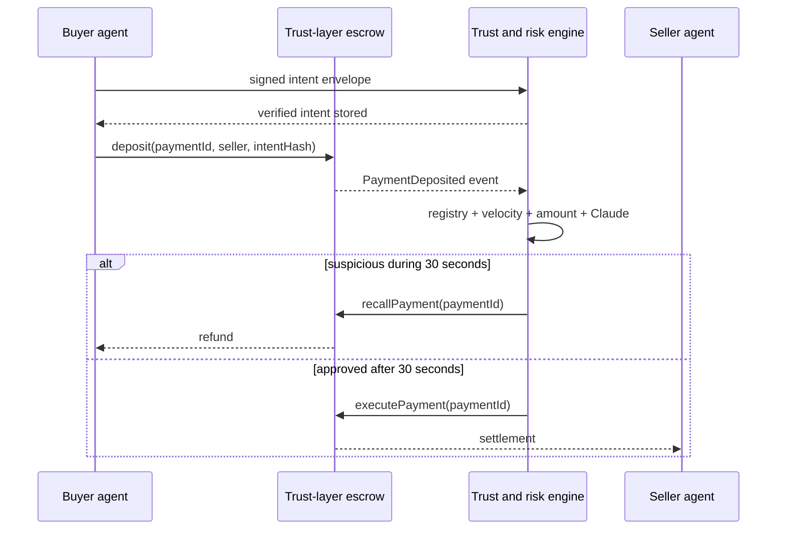

# Paradime — Autonomous Stablecoin Payments

Paradime is a hackathon-scale trust and arbitration system for autonomous
agent-to-agent payments. It provides identity, fraud screening, and reversible
settlement for payments that use blockchain rails.

> This is a prototype, not audited payment infrastructure. The contract moves
> a configurable Sepolia ERC-20 stablecoin. Production use would still require
> hardened key management and an independent security audit.

## What is included

- **On-chain escrow:** a Solidity contract with a 30-second fraud recall window,
  arbitrator-only resolution, replay protection, reentrancy protection, and a
  sender escape hatch for abandoned payments.
- **Autonomous fraud engine:** FastAPI + SQLAlchemy service combining registry,
  amount, and velocity rules with an optional Claude risk assessment.
- **Event-driven settlement:** an async `web3.py` listener ingests Sepolia
  deposit and resolution events from a durable cursor, retries arbitration, and
  reconciles local records with contract state.
- **Signed intent:** the browser wallet signs the complete purchase intent and
  the escrow commits its canonical hash, preventing the backend from screening
  a generic or substituted memo.
- **Autonomous purchase:** an owner-signed budget mandate authorizes a dedicated
  buyer session wallet to discover a seller MCP tool, negotiate an x402 v2
  challenge, pay through Paradime, and receive deterministic compute without a
  second owner signature.
- **Live operations dashboard:** a React/Vite interface updated over WebSocket,
  with a credential-free simulation mode for demos.



## Quick start (simulation mode)

Prerequisites: Node.js 22+, npm, and [`uv`](https://docs.astral.sh/uv/).

```bash
make install
make test
```

In two terminals:

```bash
make dev-backend
make dev-frontend
```

Open <http://localhost:5173>. The API is documented at
<http://localhost:8000/docs>. Simulation mode seeds representative payments and
lets the **Simulate payment** form exercise the full scoring and WebSocket UI
without a wallet or API key.

The API also runs a complete credential-free autonomous purchase. It creates a
simulated owner signature, enforces a 3 USDC mandate, pays the 1 USDC seller
offer, and returns the persisted result:

```bash
curl -sS http://localhost:8000/api/autonomous/demo \
  -H 'content-type: application/json' \
  -d '{"prompt":"Classify this trusted and safe compute result","budget_units":"3000000"}'
```

For a caller-owned mandate, fetch the delegate address from
`GET /api/autonomous/buyer`, sign the canonical mandate described by the API
schema, register it at `POST /api/autonomous/mandates`, then submit any purchase
within its remaining limits to `POST /api/autonomous/purchases`. Purchase calls
do not request another owner signature.

## Sepolia mode

Sepolia mode uses Circle-issued test USDC at
`0x1c7D4B196Cb0C7B01d743Fbc6116a902379C7238`. Testnet tokens have no financial
value. The payment page connects an EIP-1193 browser wallet, requests a USDC
allowance, and deposits into the deployed escrow. The dashboard links the
deposit, resolution, wallets, block, token, and escrow to Sepolia Etherscan.

Before starting, fund the browser wallet with Sepolia ETH for gas and test USDC
from the [Circle testnet faucet](https://faucet.circle.com/).

1. The repository includes `secrets/sepolia.env`, encrypted with SOPS to this
   workstation's age key. Fund the public addresses listed in
   `secrets/README.md`, then deploy without writing plaintext keys:

   ```bash
   cd contracts
   with-secrets ../secrets/sepolia.env -- npm run deploy:sepolia
   ```

   Record the printed address, then source-verify the exact production build
   (the encrypted environment must include `ETHERSCAN_API_KEY`):

   ```bash
   with-secrets ../secrets/sepolia.env -- npm run verify:sepolia -- \
     DEPLOYED_ADDRESS PAYMENT_TOKEN_ADDRESS ARBITRATOR_ADDRESS
   ```

2. Configure the backend with the deployed address and the same arbitrator
   wallet:

   ```bash
   cd backend
   with-secrets ../secrets/sepolia.env -- uv run uvicorn app.main:app --reload
   ```

3. Start the frontend, open the payment page, and connect the funded browser
   wallet:

   ```bash
   cd frontend
   npm run dev
   ```

   The wallet must be on Ethereum Sepolia. The wallet signs an intent message,
   then may require two transactions: one USDC approval and one escrow deposit.
   The backend waits for the configured confirmation depth before showing the
   payment and later submits the execute/recall transaction.

4. Optionally set `ANTHROPIC_API_KEY`. If Claude is unavailable, the fraud
   engine fails closed to its deterministic rules rather than skipping review.

5. To enable autonomous Sepolia purchases, also provide encrypted
   `AUTONOMOUS_BUYER_PRIVATE_KEY` and `SELLER_ADDRESS`. Fund only the dedicated
   buyer wallet with the test ETH and test USDC needed for the mandate. Paradime
   enforces the signed policy before signing approval and escrow transactions;
   the raw key itself is not an on-chain constrained smart-account session key.

Private keys and API keys must never be committed. For durable local secrets,
store them as SOPS-encrypted files under `secrets/` and launch commands through
`with-secrets`.

## Repository layout

```text
contracts/   Solidity escrow, Hardhat config, deployment, and unit tests
backend/     FastAPI service, fraud engine, chain listener, and API tests
frontend/    React/Vite real-time operations dashboard
docs/        Architecture and threat-model notes
```

## Useful commands

```bash
make format       # format/lint all three workspaces
make test         # backend and contract tests + production frontend build
make dev-backend  # FastAPI on :8000
make dev-frontend # Vite on :5173
```

## License

MIT. Paradime is an independent hackathon prototype.
