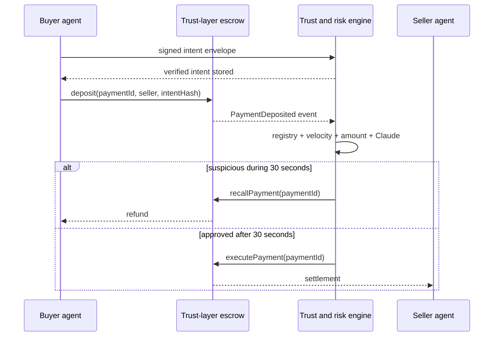

# Paradime — Autonomous Stablecoin Payments

Paradime is a hackathon-scale trust and arbitration system for autonomous
agent-to-agent payments. It provides identity, fraud screening, and reversible
settlement for payments that use blockchain rails.

> This is a prototype, not audited payment infrastructure. The contract moves
> a configurable Sepolia ERC-20 stablecoin. Production use would still require
> hardened key management and an independent security audit.

## What is included

- **On-chain escrow:** a Solidity contract with a 30-second fraud recall window,
  arbitrator-only resolution, replay protection, reentrancy protection, and a
  sender escape hatch for abandoned payments.
- **Autonomous fraud engine:** FastAPI + SQLAlchemy service combining registry,
  amount, and velocity rules with an optional Claude risk assessment.
- **Event-driven settlement:** an async `web3.py` listener ingests Sepolia
  deposit and resolution events from a durable cursor, retries arbitration, and
  reconciles local records with contract state.
- **Signed intent:** the browser wallet signs the complete purchase intent and
  the escrow commits its canonical hash, preventing the backend from screening
  a generic or substituted memo.
- **Autonomous purchase:** an owner-signed budget mandate authorizes a dedicated
  buyer session wallet to discover a seller MCP tool, negotiate an x402 v2
  challenge, pay through Paradime, and receive deterministic compute without a
  second owner signature.
- **Live operations dashboard:** a React/Vite interface updated over WebSocket,
  with a credential-free simulation mode for demos.



## Quick start (real Sepolia demo)

Prerequisites: Node.js 22+, npm, and [`uv`](https://docs.astral.sh/uv/).

```bash
./demo
```

`make demo` remains available as an equivalent command.

This installs missing frontend dependencies from the lockfile, starts the API
and frontend, and opens the interactive playground at
<http://127.0.0.1:5173/demo>. Python dependencies are managed by `uv`. The launcher
loads `secrets/sepolia.env` through `with-secrets`, validates the existing escrow,
and enables the funded demo payer. This requires the workstation's SOPS access
and `with-secrets`; it never writes decrypted keys to disk. If a port is busy,
the launcher prints the actual URLs.

**Demo means testnet:** purchases spend actual Circle test USDC and Sepolia ETH
for gas. Approval, deposit, and settlement/refund transactions have Etherscan
links in the guided flow, browser terminal, local CLI, and payment dashboard.
Use **Use browser wallet** for MetaMask or another EIP-1193 wallet; the payment
console supports direct and guided wallet payments. For automated demonstrations,
the explicitly enabled server-managed payer submits the transactions.

The playground includes:

- A guided tour of autonomous compute purchase, watchlist recall, budget
  rejection, and signed-mandate replay rejection.
- Editable purchase inputs, a decision timeline, persisted risk evidence,
  signed mandate inspection, x402 messages, and downloadable demo records.
- An in-browser terminal that uses the same command dispatcher as the local CLI.
- A clearly labeled liquidation-protection concept lab with adjustable leverage,
  price shocks, mock reserves, and mock payouts. Its premium is illustrative;
  options pricing and underwriting are not implemented.

Signatures, budget enforcement, replay rejection, risk scoring, and seller proof
checks run in the backend; successful purchases wait for mined escrow execution.
Budget and replay rejections send no transaction and have no fabricated explorer
link. The x402 demo uses the custom `paradime-escrow` scheme and an in-process
seller; it does not establish interoperability with arbitrary sellers. Without
`SELLER_ADDRESS`, the configured arbitration wallet receives seller payments;
this demo does not claim independently operated seller infrastructure.

In another terminal, use the real CLI:

```bash
./paradime doctor
./paradime buy --budget 3
./paradime pay --scenario watchlist
./paradime demo budget
./paradime demo replay
./paradime payments
./paradime --json receipt latest
```

For a non-default API port, add `--api-url http://127.0.0.1:PORT`, using the URL
printed by the launcher. The browser terminal executes only these bounded demo
commands; it has no operating-system shell access. **Reset view** clears the
playground's presentation history. **Ctrl+C** stops both servers. Sepolia records
persist in the ignored `backend/paradime-demo.db` across restarts. Commands
publish transaction links while pending; use `./paradime status OPERATION_ID`
to resume tracking without sending another payment.

The existing escrow has a 30-second recall window. The launcher therefore
observes freshly mined logs (`CHAIN_CONFIRMATIONS=0`) and uses deterministic
screening. This is low-latency testnet processing, not finalized-block protection.
After a server interruption, transaction evidence remains available and local
payment state reconciles; interrupted seller workflows are not automatically
replayed. Use `./paradime resume OPERATION_ID` or **Resume existing payment** to
finish already-paid work without another deposit. Never create a new payment
to recover an existing one without inspecting its chain state.

Offline simulation remains an explicit alternative, with no on-chain evidence:

```bash
./demo --simulation
./paradime --simulation buy --budget 3
```

That alternative uses a temporary database. Missing Sepolia configuration never
silently switches the default demo or CLI to mocked payments.

To suppress browser opening or choose ports:

```bash
make demo DEMO_ARGS="--no-open --port 5174 --api-port 8001"
```

For normal development with a persistent database, install all workspaces and
run the two servers separately:

```bash
make install
make test
make dev-backend
# In another terminal:
make dev-frontend
```

Open <http://localhost:5173>. The API is documented at
<http://localhost:8000/docs>. Simulation mode seeds representative payments and
lets the **Simulate payment** form exercise the full scoring and WebSocket UI
without a wallet or API key.

The header environment switch selects Simulation or Testnet across the payment
console, dashboard, and agent links. Testnet remains disabled until the backend
has complete Sepolia settings and either `TESTNET_ENABLED=true` or
`SIMULATION_MODE=false`. Simulation remains available after Testnet is enabled,
so changing environments does not require restarting the frontend.

The API also runs a complete credential-free autonomous purchase. It creates a
simulated owner signature, enforces a 3 USDC mandate, pays the 1 USDC seller
offer, and returns the persisted result:

```bash
curl -sS http://localhost:8000/api/autonomous/demo \
  -H 'content-type: application/json' \
  -d '{"prompt":"Classify this trusted and safe compute result","budget_units":"3000000"}'
```

For a caller-owned mandate, fetch the delegate address from
`GET /api/autonomous/buyer`, sign the canonical mandate described by the API
schema, register it at `POST /api/autonomous/mandates`, then submit any purchase
within its remaining limits to `POST /api/autonomous/purchases`. Purchase calls
do not request another owner signature.

## Sepolia mode

Sepolia mode uses Circle-issued test USDC at
`0x1c7D4B196Cb0C7B01d743Fbc6116a902379C7238`. Testnet tokens have no financial
value. The payment page can use either the application-managed demo payer or an
EIP-1193 browser wallet. Both paths create the same signed intent, request a
USDC allowance when needed, and deposit into the deployed escrow. The dashboard
links the deposit, resolution, wallets, block, token, and escrow to Sepolia
Etherscan.

Before starting, fund the browser wallet with Sepolia ETH for gas and test USDC
from the [Circle testnet faucet](https://faucet.circle.com/).

1. The repository includes `secrets/sepolia.env`, encrypted with SOPS to this
   workstation's age key. Fund the public addresses listed in
   `secrets/README.md`, then deploy without writing plaintext keys:

   ```bash
   cd contracts
   with-secrets ../secrets/sepolia.env -- npm run deploy:sepolia
   ```

   Record the printed address, then source-verify the exact production build
   (the encrypted environment must include `ETHERSCAN_API_KEY`):

   ```bash
   with-secrets ../secrets/sepolia.env -- npm run verify:sepolia -- \
     DEPLOYED_ADDRESS PAYMENT_TOKEN_ADDRESS ARBITRATOR_ADDRESS
   ```

2. Configure the backend with the deployed address and the same arbitrator
   wallet. Set `TESTNET_ENABLED=true` to keep Simulation as the default while
   enabling the UI switch, or retain `SIMULATION_MODE=false` to default the UI
   to Testnet:

   ```bash
   cd backend
   with-secrets ../secrets/sepolia.env -- uv run uvicorn app.main:app --reload
   ```

   For a controlled demo, expose the encrypted deployer/demo-payer wallet to
   the application for this process only. The UI then defaults to **Demo
   wallet**, while **Connect wallet** remains available:

   ```bash
   with-secrets ../secrets/sepolia.env -- env \
     TESTNET_ENABLED=true MANAGED_DEMO_WALLET_ENABLED=true \
     uv run uvicorn app.main:app --reload
   ```

   The managed route is off by default, enforces configurable per-payment and
   per-process-session limits, and never sends the private key to the browser.

3. Start the frontend and open the payment page. Use the built-in demo payer,
   or choose **Connect wallet** to use a funded browser wallet:

   ```bash
   cd frontend
   npm run dev
   ```

   The wallet must be on Ethereum Sepolia. The wallet signs an intent message,
   then may require two transactions: one USDC approval and one escrow deposit.
   The backend waits for the configured confirmation depth before showing the
   payment and later submits the execute/recall transaction.

4. Optionally set `ANTHROPIC_API_KEY`. If Claude is unavailable, the fraud
   engine fails closed to its deterministic rules rather than skipping review.

5. To enable autonomous Sepolia purchases, also provide encrypted
   `AUTONOMOUS_BUYER_PRIVATE_KEY` and `SELLER_ADDRESS`. Fund only the dedicated
   buyer wallet with the test ETH and test USDC needed for the mandate. Paradime
   enforces the signed policy before signing approval and escrow transactions;
   the raw key itself is not an on-chain constrained smart-account session key.

Private keys and API keys must never be committed. For durable local secrets,
store them as SOPS-encrypted files under `secrets/` and launch commands through
`with-secrets`.

## Repository layout

```text
contracts/   Solidity escrow, Hardhat config, deployment, and unit tests
backend/     FastAPI service, fraud engine, chain listener, and API tests
frontend/    React/Vite real-time operations dashboard
docs/        Architecture and threat-model notes
```

## Useful commands

```bash
make format       # format/lint all three workspaces
make test         # backend and contract tests + production frontend build
./demo            # real Sepolia playground + browser terminal; opens the browser
./demo --simulation # explicitly choose offline simulation
./paradime help   # Sepolia CLI (requires the demo API to be running)
make dev-backend  # FastAPI on :8000
make dev-frontend # Vite on :5173
```

## License

MIT. Paradime is an independent hackathon prototype.
