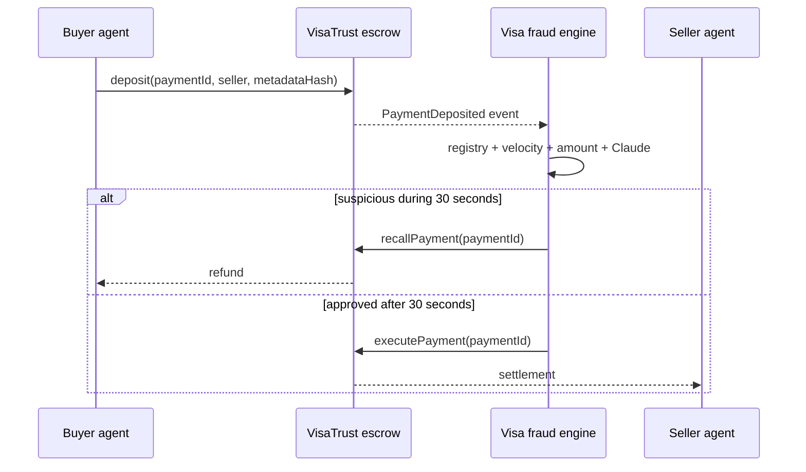

# VisaTrust — Agentic Stablecoin Payments

VisaTrust is a hackathon-scale trust and arbitration layer for autonomous
agent-to-agent payments. It demonstrates how Visa could provide identity,
fraud screening, and reversible settlement for payments that use blockchain
rails instead of cards.

> This is a prototype, not audited payment infrastructure. The contract moves
> a configurable Sepolia ERC-20 stablecoin. Production use would still require
> hardened key management and an independent security audit.

## What is included

- **On-chain escrow:** a Solidity contract with a 30-second fraud recall window,
  arbitrator-only resolution, replay protection, reentrancy protection, and a
  sender escape hatch for abandoned payments.
- **Autonomous fraud engine:** FastAPI + SQLAlchemy service combining registry,
  amount, and velocity rules with an optional Claude risk assessment.
- **Event-driven settlement:** an async `web3.py` listener ingests Sepolia
  `PaymentDeposited` events and signs `executePayment` or `recallPayment` calls.
- **Live operations dashboard:** a React/Vite interface updated over WebSocket,
  with a credential-free simulation mode for demos.



## Quick start (simulation mode)

Prerequisites: Node.js 22+, npm, and [`uv`](https://docs.astral.sh/uv/).

```bash
make install
make test
```

In two terminals:

```bash
make dev-backend
make dev-frontend
```

Open <http://localhost:5173>. The API is documented at
<http://localhost:8000/docs>. Simulation mode seeds representative payments and
lets the **Simulate payment** form exercise the full scoring and WebSocket UI
without a wallet or API key.

## Sepolia mode

1. Deploy the contract:

   ```bash
   cp contracts/.env.example contracts/.env
   cd contracts
   npm run deploy:sepolia
   ```

2. Configure the backend with the deployed address and the same arbitrator
   wallet:

   ```bash
   cp backend/.env.example backend/.env
   # Set SIMULATION_MODE=false, SEPOLIA_RPC_URL,
   # ESCROW_CONTRACT_ADDRESS, and ARBITRATOR_PRIVATE_KEY.
   cd backend
   uv run uvicorn app.main:app --reload
   ```

3. Optionally set `ANTHROPIC_API_KEY`. If Claude is unavailable, the fraud
   engine fails closed to its deterministic rules rather than skipping review.

Private keys and API keys must never be committed. For durable local secrets,
store them as SOPS-encrypted files under `secrets/` and launch commands through
`with-secrets`.

## Repository layout

```text
contracts/   Solidity escrow, Hardhat config, deployment, and unit tests
backend/     FastAPI service, fraud engine, chain listener, and API tests
frontend/    React/Vite real-time operations dashboard
docs/        Architecture and threat-model notes
```

## Useful commands

```bash
make format       # format/lint all three workspaces
make test         # backend and contract tests + production frontend build
make dev-backend  # FastAPI on :8000
make dev-frontend # Vite on :5173
```

## License

MIT. VisaTrust is an independent hackathon prototype and is not an official
Visa product.
